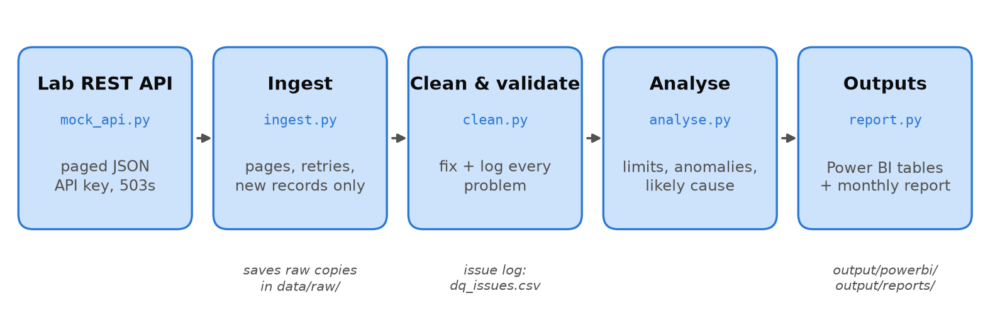
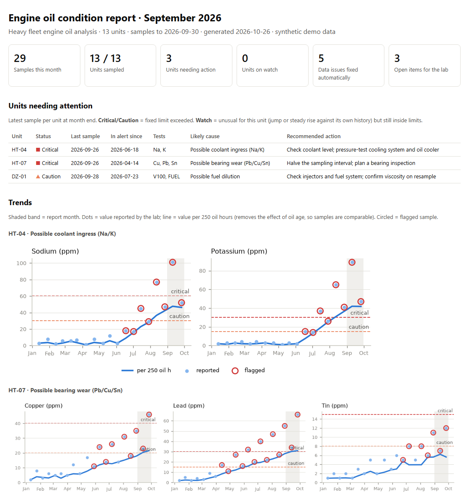
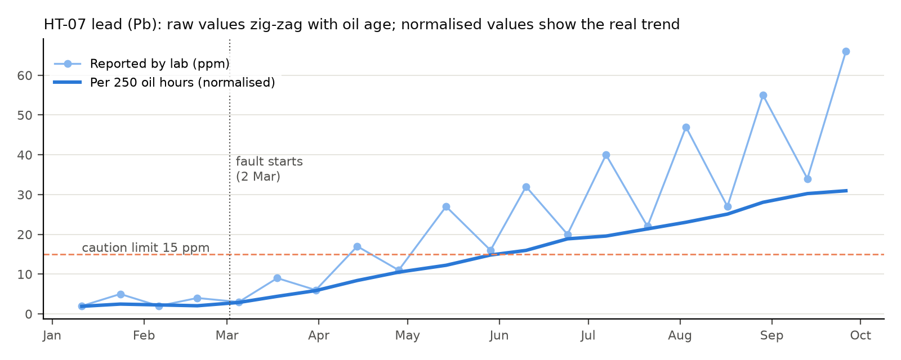
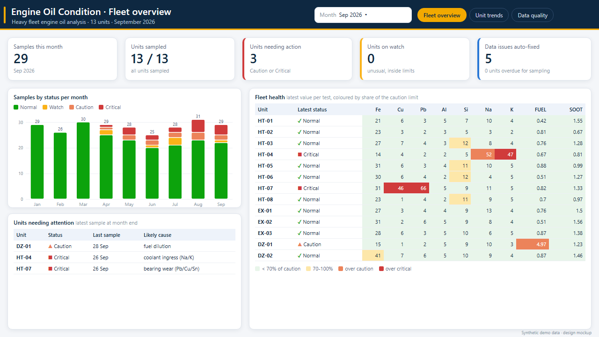
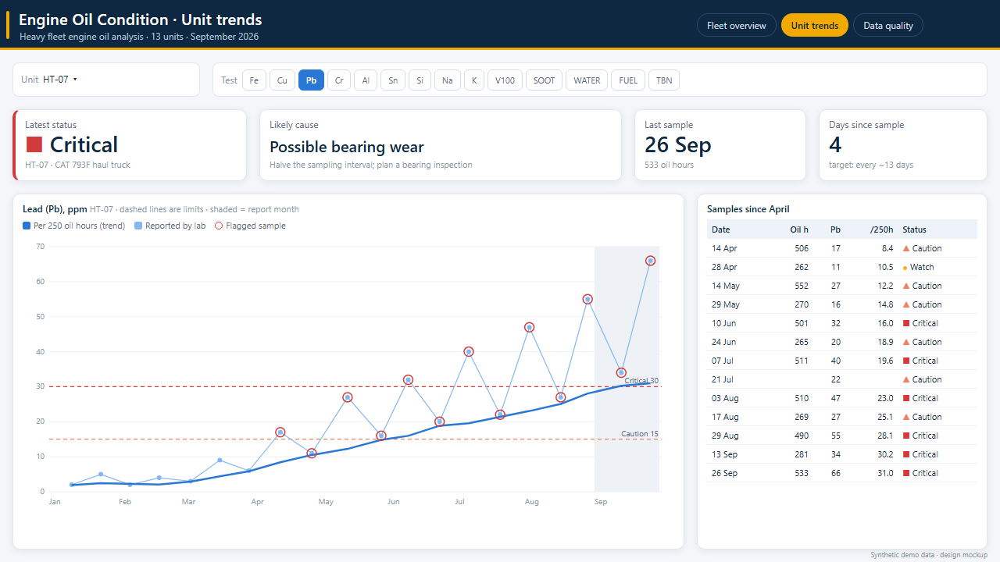
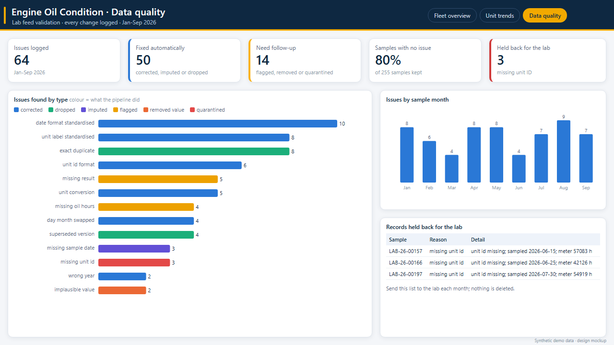

# Engine oil condition monitoring: lab API → clean data → alerts → Power BI

A small end-to-end project that copies the workflow of monitoring engine oil analysis for a
mining fleet: pull results from a lab's REST API, clean and validate them, flag samples outside
limits or unusual for that machine, and publish tables for Power BI plus a short monthly report.

All data is **synthetic** (13 haul trucks, excavators and dozers, Jan–Sep 2026). That was on purpose:
because I seeded the faults and data errors myself, I can **measure** how well the pipeline finds them
instead of just assuming it works.



**Monthly report generated by the pipeline** (top of the September report; [full page](docs/images/monthly_report_full.png)):



## Results

| What was tested | Result |
|---|---|
| Injected data errors (duplicates, amended re-issues, bad dates, unit mix-ups, missing fields, impossible values) | **64 / 64 caught**; every swapped or wrong-year date, water-in-ppm value and amended Fe result restored to its true value |
| Seeded machine faults (bearing wear, dust ingestion, coolant leak, fuel dilution) | **4 / 4 detected**, 8–43 days after onset, all with the right likely cause |
| Contaminated sample bottle (one-off spike) | Recognised as an isolated spike → "resample before acting", not a fault |
| False alarms | 4 of 255 samples (1.6%), all low-level "Watch" flags |
| Anomaly layer vs fixed limits | Caught 3 in-fault samples that fixed limits reported as Normal; 13 days earlier on fuel dilution; same sample as limits on the other three faults |
| Repeated on 10 random datasets (`experiments/multi_seed.py`) | 64/64 errors and 4/4 faults every time; right cause 38/40; false alarms 0.4–2.0%. On the three gradual faults the anomaly flag came **11–41 days before** the fixed limits in 25 of 30 cases (the default dataset is one of the least favourable). Sudden dust ingestion: same sample, as expected |

What I learned from it:
- **Oil hours matter.** Wear metals build up while oil is in service, so a 500 h sample reads about twice
  a 250 h one. On the bearing-wear truck, fixed limits went Caution → Normal → Caution between samples
  just because of oil age. Normalising to 250 oil hours gives a steady trend.

  
- **Tuning has a cost.** Loosening the trend rule to get an earlier warning on bearing wear gave no
  earlier detection and nearly doubled false alarms, so I kept the stricter setting.
- **Looking at the charts caught a bug the summary numbers missed:** a 10%-of-median noise floor, meant
  for wear metals, meant viscosity needed a ~5 cSt drop before it could ever be flagged. After the fix the
  anomaly layer flags the fuel-dilution viscosity drop (z ≈ −5); the fault itself was already caught
  earlier through the fuel dilution reading.

Full scoring: [output/evaluation.md](output/evaluation.md). Run `py run_demo.py` to regenerate the data, report and Power BI tables.

## Power BI dashboard

Three pages: fleet overview, unit trends, data quality. Custom theme, page backgrounds, colour-coded status
(always with a symbol, never colour alone) and a step-by-step build guide with exact layout:
[powerbi/DASHBOARD_DESIGN.md](powerbi/DASHBOARD_DESIGN.md).

<!-- Replace these design mockups with screenshots of your built Power BI report. -->
| Fleet overview | Unit trends | Data quality |
|---|---|---|
|  |  |  |

*Design mockups drawn from the pipeline's real output tables (September 2026).*

## How it works

| Step | File | What it does |
|---|---|---|
| Mock lab API | `oilmon/mock_api.py` | Paged `/v1/samples` endpoint with API key, `modified_since` filter and random 503s |
| Ingest | `oilmon/ingest.py` | Follows pages, retries with back-off, only asks for records changed since the last pull, saves raw JSON |
| Clean | `oilmon/clean.py` | Checks below; every change goes to `dq_issues.csv`, unusable records to `quarantine.csv` |
| Analyse | `oilmon/analyse.py` | Fixed limits, anomaly detection, likely cause and recommended action per sample |
| Report | `oilmon/report.py` | Self-contained monthly HTML: units needing action, trend charts, sampling status, data quality |
| Evaluate | `oilmon/evaluate.py` | Scores everything against the synthetic ground truth |
| Power BI | `powerbi/` | Theme, page backgrounds, DAX measures, dashboard build guide, and a Power Query (M) version that calls the API directly |

```
oil-condition-monitoring/
├── run_demo.py            one command: data → API → pipeline → report → evaluation
├── oilmon/                the pipeline (config, generate_data, mock_api, ingest, clean, analyse, report, evaluate)
├── config/limits.csv      caution / critical limits per test
├── experiments/           explore one unit, call the API by hand, repeat on many random datasets
├── tests/                 20 unit tests
├── powerbi/               theme, backgrounds, measures.dax, lab_api.pq, setup and design guides
├── docs/images/           README images
└── output/evaluation.md   scored results (everything else in output/ and data/ is regenerated)
```

### Data cleaning and validation

| Problem in the lab data | Check | Action |
|---|---|---|
| Same record sent twice | identical JSON | drop duplicate |
| Lab re-issues corrected results | same `sample_id`, later `updated_at` | keep newest version |
| `HT04`, `ht-04 `, `HT 04` | normalise, match against asset register | correct; unknown or missing unit → quarantine |
| Dates as `2026-03-05` and `05/03/2026` | parse both explicitly (day first) | standardise |
| Day and month swapped, wrong year | sample date after received date, or > 21 days in transit | try the swap / received year; use it if it makes sense, else estimate |
| Missing sample date | — | estimate from received date minus typical transit time, marked "imputed" |
| Water in ppm instead of %; `mg/kg` vs `ppm` | unit table | convert / relabel |
| Impossible values (e.g. viscosity 145 cSt) | plausibility range per test | remove value, ask lab |
| Missing results or oil hours | expected test list | flag (limits still apply; left out of trending) |
| Date out of order with engine hours | dates must rise with unit hours | flag |

### Anomaly detection

1. **Fixed limits**: caution and critical values per test (`config/limits.csv`, indicative; real ones come from the customer/OEM).
2. **Jump**: robust z-score of the hours-normalised value against the unit's own last 8 normal samples
   (median and MAD, so one bad sample doesn't skew the baseline). Flagged samples stay out of the baseline,
   so a developing fault doesn't become the new normal.
3. **Trend**: linear fit over the last 6 samples (R² ≥ 0.8 and a meaningful rise) for slow faults.
4. **Likely cause**: standard oil analysis signatures: Na + K = coolant, Si (+ Al) = dirt, Pb/Cu/Sn = bearings,
   fuel up or viscosity down = fuel dilution. A flagged sample with normal samples either side is reported
   as a probable sampling issue.

## Run it

Needs Python 3.10+ and `pip install -r requirements.txt`.

```
py run_demo.py                              # generate data, start mock API, run pipeline, score it
py -m unittest discover -s tests -t .      # 20 unit tests
py -m oilmon.mock_api                       # API only, e.g. for the Power Query version in Power BI
py -m oilmon.pipeline --month 2026-08       # pipeline only, report for a chosen month
py experiments/explore_unit.py HT-07 Pb     # one machine + one test: table and chart
py experiments/call_api.py                  # call the API by hand (start the API first)
py experiments/multi_seed.py                # repeat everything on several random datasets
```

Power BI: see [powerbi/POWERBI_SETUP.md](powerbi/POWERBI_SETUP.md).

## Handover: monthly routine

1. `py -m oilmon.pipeline`: pulls only new or amended results from the lab.
2. Read the console summary; open `output/powerbi/quarantine.csv` and email the lab about any held-back records.
3. Refresh the Power BI report.
4. Review `output/reports/monthly_report_YYYY-MM.html`; check that each Critical/Caution unit makes sense
   (look at its trend, not just the latest value), then send it.
5. If a limit or unit changes: edit `config/limits.csv` or `data/asset_register.csv`; no code changes needed.

## Limitations and next steps

- Synthetic data: real lab feeds will have problems I haven't thought of. The issue log is designed to show them.
- Limits are generic; they should be set per engine model with the customer.
- After a confirmed repair, the anomaly baseline should be reset for that unit (currently it relearns gradually).
- Multivariate methods (e.g. Isolation Forest across all tests) could catch combinations no single test shows;
  I chose per-test methods first because each flag can be explained to a maintenance planner.
- Production: schedule the pipeline (Task Scheduler / Azure Function), keep the API key in a secret store, and
  write to SharePoint or a database instead of local CSVs.
